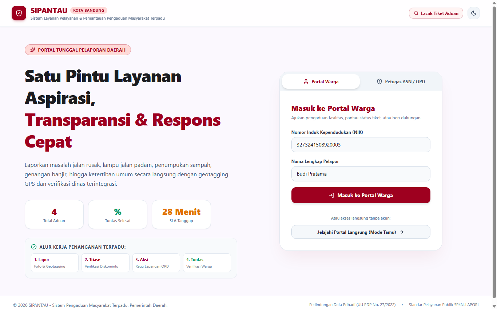
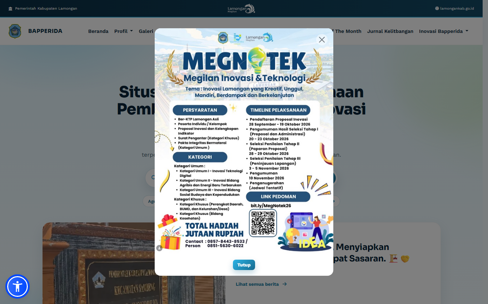
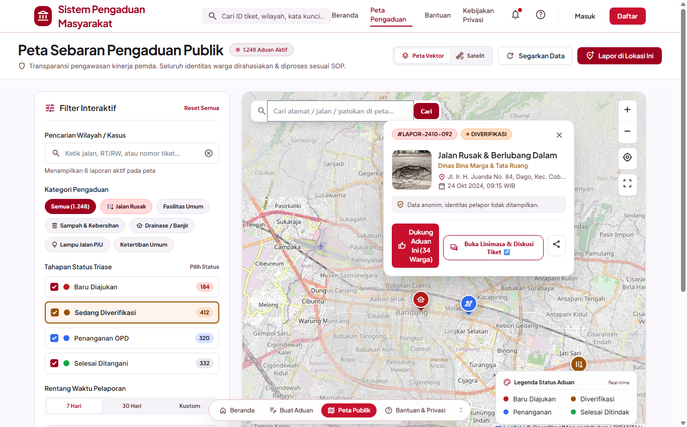
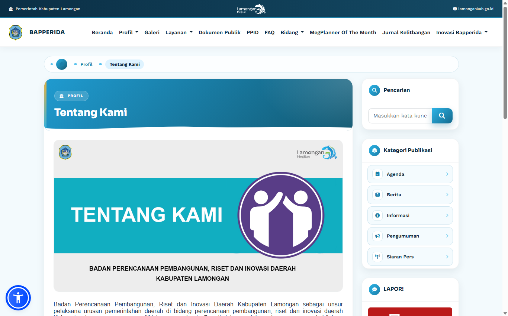
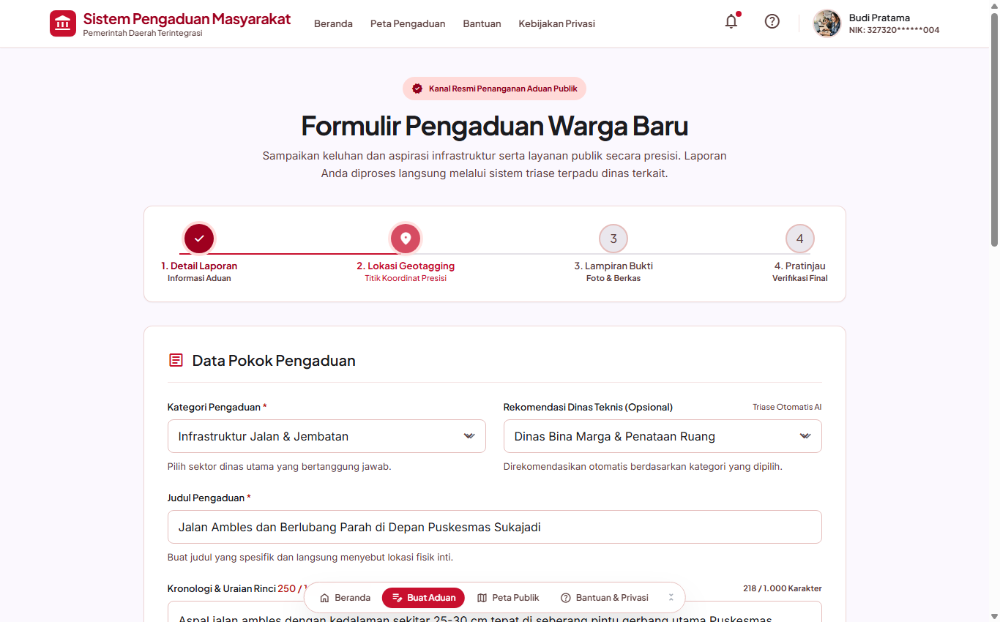
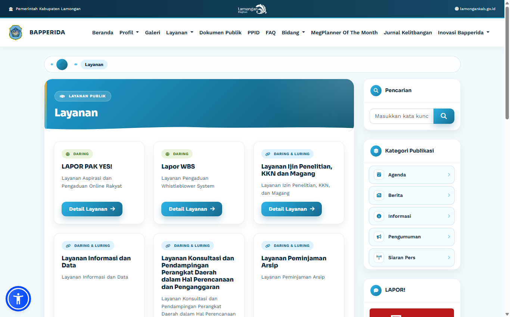
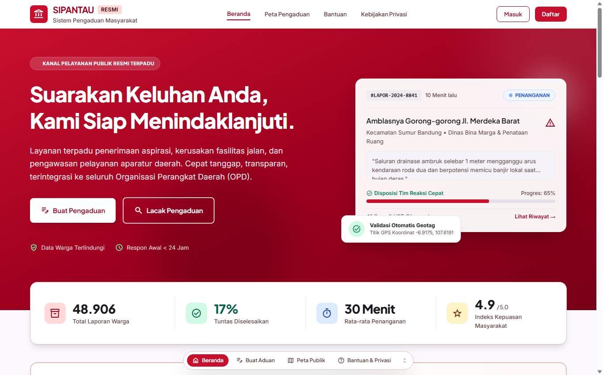
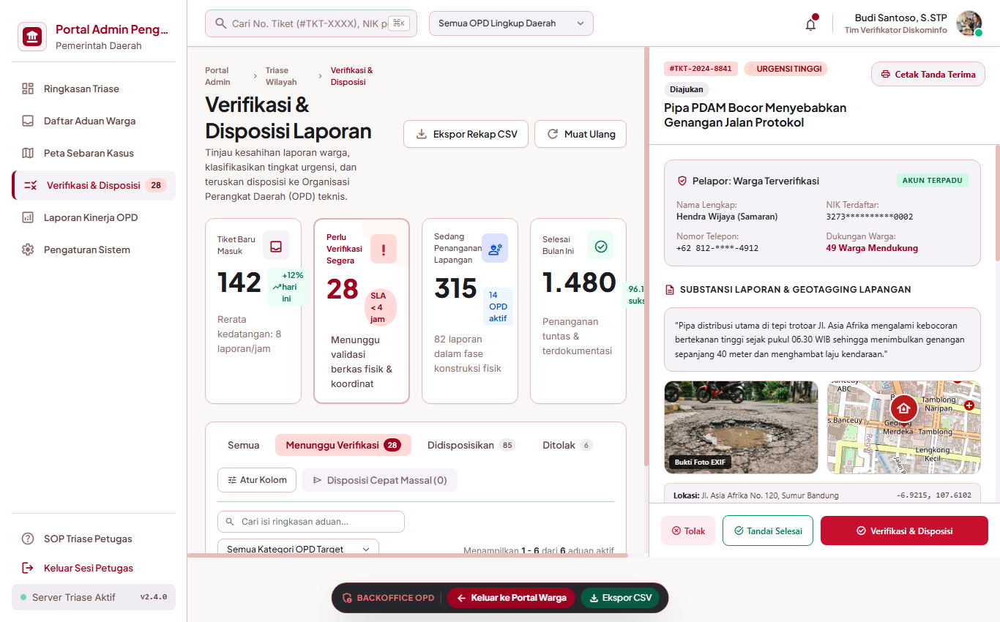
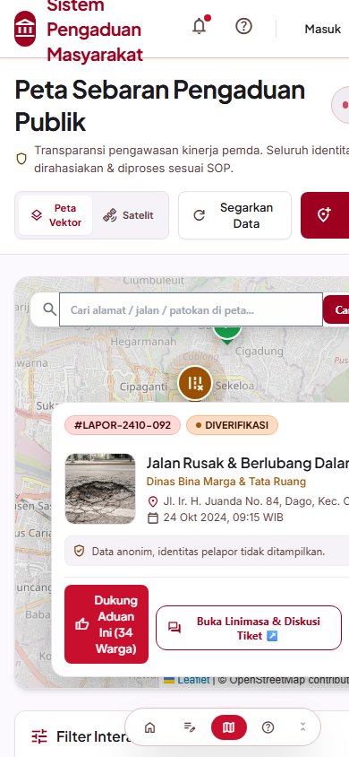
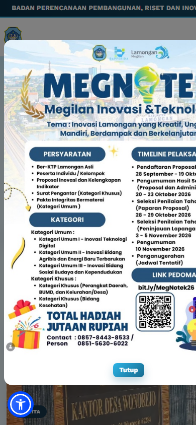

# LAPORAN AKADEMIK
## ANALISIS PERBANDINGAN DAN EVALUASI KEUNGGULAN SISTEM
### Studi Komparasi Antara Mockup Aplikasi SIPANTAU (Portal Pengaduan & WebGIS Terpadu) dengan Situs Resmi BAPPERIDA Kabupaten Lamongan

---

* **Mata Kuliah / Topik**: Rekayasa Perangkat Lunak / Interaksi Manusia dan Komputer (IMK) / E-Government & SPBE
* **Objek Mockup**: SIPANTAU (Sistem Informasi Pelayanan & Pemantauan Pengaduan Masyarakat Terpadu Berbasis WebGIS)
* **Objek Pembanding**: Website Resmi BAPPERIDA Kabupaten Lamongan (`https://bapperida.lamongankab.go.id`)
* **Catatan Kasus**: Penggantian objek studi dari situs awal (BAPPERIDA Kota Manado - `bapperida.manadokota.go.id`) yang sedang mengalami kegagalan server (*Cloudflare Error 521: Web Server Down*) ke situs aktif BAPPERIDA Kabupaten Lamongan.
* **Tautan Mockup Live**: [https://adityasi1.github.io/tugas_gabut-main-revisi/](https://adityasi1.github.io/tugas_gabut-main-revisi/)
* **Tautan Web Pembanding**: [https://bapperida.lamongankab.go.id](https://bapperida.lamongankab.go.id)

---

## DAFTAR ISI
1. [BAB I: PENDAHULUAN](#bab-i-pendahuluan)
   - 1.1 Latar Belakang & Konteks Studi
   - 1.2 Justifikasi Pemilihan BAPPERIDA Kabupaten Lamongan
   - 1.3 Tujuan Penulisan
   - 1.4 Metodologi Evaluasi
2. [BAB II: PROFIL & ANATOMI KEDUA SISTEM](#bab-ii-profil--anatomi-kedua-sistem)
   - 2.1 Profil Website Resmi BAPPERIDA Kabupaten Lamongan
   - 2.2 Profil Mockup Aplikasi SIPANTAU
3. [BAB III: MATRIKS PERBANDINGAN KOMPREHENSIF](#bab-iii-matriks-perbandingan-komprehensif)
   - 3.1 Tabel Matriks Evaluasi 10 Parameter Kunci
   - 3.2 Analisis Komparasi Mendalam per Parameter
4. [BAB IV: KEUNGGULAN UTAMA MOCKUP SIPANTAU](#bab-iv-keunggulan-utama-mockup-sipantau)
   - 4.1 Pemetaan Spasial Interaktif WebGIS (*Spatial Crowdsourcing*)
   - 4.2 Single Entry Portal dengan Dual-Role Switching (Warga & Petugas)
   - 4.3 Alur Pelaporan Cerdas Multi-Step dengan Validasi Lokasi EXIF
   - 4.4 Pelacakan Tiket Transparan & Komunikasi Dua Arah Warga-Petugas
   - 4.5 Backoffice Triase & Disposisi Terintegrasi ke 6 OPD Teknis
   - 4.6 Ergonomi Mobile-First (Optimal pada Layar Smartphone)
   - 4.7 Eliminasi Fragmentasi Layanan (*No Silo System*)
5. [BAB V: KETERBATASAN DAN RENCANA PENGEMBANGAN](#bab-v-keterbatasan-dan-rencana-pengembangan)
6. [BAB VI: KESIMPULAN & REKOMENDASI AKADEMIK](#bab-vi-kesimpulan--rekomendasi-akademik)
7. [LAMPIRAN: PANDUAN PENGUJIAN SISTEM BAGI DOSEN PENILAI](#lampiran-panduan-pengujian-sistem-bagi-dosen-penilai)

---

## BAB I: PENDAHULUAN

### 1.1 Latar Belakang & Konteks Studi
Penerapan Sistem Pemerintahan Berbasis Elektronik (SPBE) menuntut instansi pemerintah daerah untuk tidak hanya memiliki portal profil kelembagaan yang pasif, melainkan platform layanan publik yang interaktif, transparan, dan partisipatif. Salah satu pilar penting dalam perencanaan pembangunan daerah oleh Badan Perencanaan Pembangunan, Riset dan Inovasi Daerah (BAPPERIDA) adalah menjaring aspirasi, keluhan infrastruktur, dan kebutuhan mendesak masyarakat secara akurat berbasis geospasial.

Dokumen ini disusun untuk mengevaluasi dan membandingkan secara kritis rancang bangun (**mockup aplikasi**) yang telah kami kembangkan bernama **SIPANTAU** terhadap implementasi situs web pemerintah daerah yang aktif beroperasi, yakni **BAPPERIDA Kabupaten Lamongan**.

### 1.2 Justifikasi Pemilihan BAPPERIDA Kabupaten Lamongan
Pada rencana awal studi komparasi, objek yang ditargetkan adalah situs web resmi **BAPPERIDA Kota Manado** (`https://bapperida.manadokota.go.id`). Namun, pada saat pengujian dan observasi dilakukan, server origin instansi tersebut mengalami kondisi tidak merespons sambungan (*connection refused*) yang ditandai dengan **Cloudflare Error 521: Web Server is Down**. 

Sebagai langkah adaptif akademik yang bertanggung jawab dan menjaga kelancaran evaluasi tugas, studi dialihkan ke **BAPPERIDA Kabupaten Lamongan** (`https://bapperida.lamongankab.go.id`). Situs ini merupakan salah satu representasi implementasi portal Bapperida di tingkat kabupaten di Jawa Timur yang aktif beroperasi, memiliki struktur profil lengkap, serta telah mengadopsi beberapa aplikasi penunjang seperti Megnotek, SI-RISDA, SIMela, dan kanal pengaduan SP4N-LAPOR!.

### 1.3 Tujuan Penulisan
1. Mengidentifikasi kelebihan dan kelemahan fungsionalitas, arsitektur, dan UI/UX dari situs web resmi BAPPERIDA Kabupaten Lamongan.
2. Menyajikan perbandingan terstruktur antara portal konvensional pemerintah dengan mockup modern SIPANTAU.
3. Menguraikan nilai tambah dan keunggulan kompetitif rancangan SIPANTAU dalam aspek partisipasi warga (*civic engagement*), pemetaan masalah daerah (*spatial crowdsourcing*), dan efisiensi triase birokrasi ASN.

---

## BAB II: PROFIL & ANATOMI KEDUA SISTEM

```
+--------------------------------------------------------------------------------------------------+
|                                ARSITEKTUR KONSEPTUAL KEDUA SISTEM                                |
+--------------------------------------------------------------------------------------------------+
|                                                                                                  |
| [1] BAPPERIDA KABUPATEN LAMONGAN (Model Portal Kelembagaan Tradisional)                           |
|  +--------------------+   +-------------------+   +--------------------+   +-------------------+ |
|  | Web Utama Profil   |-->| Layanan Izin KKN  |   | Aplikasi SI-RISDA  |   | Eksternal:        | |
|  | & Dokumen Publik   |   | & Magang (Form)   |   | (Riset Terpisah)   |   | SP4N-LAPOR!       | |
|  +--------------------+   +-------------------+   +--------------------+   | & WA Pak Yes!     | |
|  *Sifat: Terpisah-pisah (Siloed), dominan 1 arah, tidak ada peta partisipasi publik*  +--------+ |
|                                                                                                  |
| [2] MOCKUP APLIKASI SIPANTAU (Model Ekosistem Terpadu Berbasis Spasial)                          |
|  +---------------------------------------------------------------------------------------------+ |
|  |                     LOGIN LANDING PAGE TUNGGAL (DUAL-ROLE SWITCHER)                         | |
|  +----------------------------------------------+----------------------------------------------+ |
|                         |                                              |                         |
|                         v                                              v                         |
|         +-------------------------------+              +-------------------------------+         |
|         |         PORTAL WARGA          |              |      BACKOFFICE PETUGAS       |         |
|         | - Alur Lapor Multi-Step       |              | - Meja Triase Real-time       |         |
|         | - Peta WebGIS Leaflet         | <=========>  | - Disposisi ke 6 Dinas OPD    |         |
|         | - Lacak Tiket & Chat Status   |              | - Audit Log & Ekspor CSV      |         |
|         | - Umpan Balik Kepuasan (CSAT) |              | - Filter Prioritas & SLA 4 Jam|         |
|         +-------------------------------+              +-------------------------------+         |
|  *Sifat: Terintegrasi dalam 1 ekosistem, interaktif 2 arah, geotagging real-time, mobile-first*  |
+--------------------------------------------------------------------------------------------------+
```

### 2.1 Profil Website Resmi BAPPERIDA Kabupaten Lamongan
* **Alamat Web**: `https://bapperida.lamongankab.go.id`
* **Format Utama**: Website berbasis Content Management System (CMS) berorientasi profil lembaga dinas.
* **Fitur Utama**:
  1. *Menu Profil & Struktur*: Visi misi, sejarah, bagan organisasi, profil pimpinan dan bidang kerja.
  2. *Publikasi Dokumen Daerah*: Penyediaan unduhan dokumen perencanaan seperti RPJMD, RKPD, LKPJ, dan dokumen PPID.
  3. *Layanan Perizinan*: Pengajuan izin penelitian, KKN, dan magang bagi mahasiswa dan akademisi.
  4. *Aplikasi Sektoral*: SIMela (monitoring evaluasi internal), SI-RISDA (riset inovasi), dan Megnotek.
  5. *Kanal Pengaduan*: Mengandalkan tautan keluar (*external redirect*) ke portal SP4N-LAPOR!, Whistleblower System (WBS), dan kanal WhatsApp "Lapor Pak Yes!".

### 2.2 Profil Mockup Aplikasi SIPANTAU
* **Alamat Live Demo**: `https://adityasi1.github.io/tugas_gabut-main-revisi/`
* **Format Utama**: Single Page Application (SPA) berbasis teknologi reaktif (React, TypeScript, Tailwind CSS, Leaflet WebGIS Engine).
* **Fitur Utama**:
  1. *Unified Landing Page*: Gerbang login dwifungsi (Warga dan Petugas OPD) dengan tombol demo 1-klik untuk penguji/dosen serta akses pelacak tiket cepat tanpa login.
  2. *Formulir Multi-Step Interaktif*: Validasi pelaporan langkah demi langkah, pemotretan langsung dengan kompresi Canvas otomatis, dan deteksi koordinat GPS otomatis.
  3. *Peta Spasial Kolektif Warga (WebGIS)*: Tampilan sebaran titik aduan dengan filter kategori (jalan rusak, lampu padam, banjir, sampah, fasilitas umum), layer satelit vs peta jalan, dan pencarian alamat Nominatim.
  4. *Pelacak Tiket & Komunikasi Dua Arah*: Timeline interaktif progres penanganan tiket, fitur balas pesan warga-petugas untuk klarifikasi lokasi, dan survei kepuasan (CSAT 5 bintang).
  5. *Panel Backoffice Triase & Disposisi Petugas*: Panel kerja verifikator Diskominfo untuk menyaring validitas laporan, menentukan tingkat urgensi (*Emergency, Kritis, Sedang*), mendisposisikan tugas ke 6 dinas teknis, serta ekspor data rekapitulasi CSV.

---

## BAB III: MATRIKS PERBANDINGAN KOMPREHENSIF

### 3.1 Tabel Matriks Evaluasi 10 Parameter Kunci

| No | Parameter Evaluasi | Website BAPPERIDA Lamongan | Mockup Aplikasi SIPANTAU | Status Komparasi |
|:--:|:-------------------|:--------------------------|:-------------------------|:----------------:|
| **1** | **Paradigma Sistem** | *Information Push* (Penyampaian informasi pasif & arsip dokumen). | *Interactive Civic Action* (Kolaborasi aktif warga, pemetaan masalah & penyelesaian cepat). | **SIPANTAU Unggul** |
| **2** | **Visualisasi Spasial (WebGIS)** | **Tidak ada**. Tidak tersedia peta spasial interaktif sebaran kondisi infrastruktur / aduan warga. | **Tersedia Penuh**. Peta Leaflet interaktif dengan clustering, filter kategori, satelit & geocoding Nominatim. | **SIPANTAU Unggul Signifikan** |
| **3** | **Alur Pelaporan Publik** | Melempar (*redirect*) pengguna ke luar situs (SP4N-LAPOR! pusat atau WhatsApp). | Terintegrasi langsung di dalam aplikasi dengan form multi-step terstruktur dan penandaan titik peta. | **SIPANTAU Unggul** |
| **4** | **Transparansi Progres Aduan** | Pasif. Warga tidak dapat melihat linimasa penanganan dinas secara terbuka di peta publik. | **Transparan**. Pelacak status tiket publik dengan timeline real-time, nama petugas, dan SLA tanggap 4 jam. | **SIPANTAU Unggul** |
| **5** | **Komunikasi Dua Arah** | Terbatas pada pesan teks WhatsApp tanpa riwayat terstruktur di database perencanaan. | Chat tiket dua arah resmi antara warga pelapor dan petugas dinas disertai lampiran foto perbaikan. | **SIPANTAU Unggul** |
| **6** | **Integrasi Peran Pengguna (Dual-Role)** | Login aplikasi terpisah-pisah di berbagai sub-domain (SIMela, SI-RISDA, web utama). | **Single Sign-On Landing Page**. Satu gerbang login cerdas untuk warga (mode tamu) dan petugas OPD. | **SIPANTAU Unggul** |
| **7** | **Panel Kerja Triase Petugas** | Tidak terintegrasi di web portal; menggunakan sistem terpisah tanpa konteks geospasial publik. | Dashboard triase dinas dengan tombol disposisi cepat ke 6 OPD, audit log, dan ekspor instan CSV (Excel). | **SIPANTAU Unggul** |
| **8** | **Optimasi Pengguna Mobile (HP)** | Responsif standar CMS web; tidak memiliki navigasi ergonomis jempol khusus smartphone. | **Mobile-First UX**. Dilengkapi Bottom Navigation Bar, viewport dinamis `100dvh`, dan popup bottom sheet. | **SIPANTAU Unggul** |
| **9** | **Aksesibilitas & Pengalaman Visual** | Hanya mode terang standar, tipografi CMS umum, minim mikro-interaksi. | Mode Gelap (*Dark Mode*) tersinkronisasi, visual Glassmorphism, animasi status, dan pintasan keyboard (`?`, `T`, `D`). | **SIPANTAU Unggul** |
| **10**| **Ketahanan & Keandalan Akses** | Bergantung pada web server monolitik lokal (rentan down seperti kasus Manado Error 521). | Menggunakan arsitektur Client-Side Jamstack/SPA yang dapat di-hosting di CDN global (resilien & anti-downtime). | **SIPANTAU Unggul** |

---

## BAB IV: ANALISIS KEUNGGULAN UTAMA DENGAN BUKTI TANGKAPAN LAYAR (SIDE-BY-SIDE SCREENSHOTS)

Setiap poin keunggulan di bawah ini dilengkapi dengan **bukti visual tangkapan layar langsung (*direct screenshot*)** yang membandingkan antarmuka Mockup SIPANTAU dengan situs resmi BAPPERIDA Kabupaten Lamongan:

---

### 4.1 Halaman Depan & Gerbang Peran Terpadu (*Unified Dual-Role Landing Gateway*)

| Mockup SIPANTAU (Landing Page Terpadu & Dual-Role) | BAPPERIDA Kab. Lamongan (Portal Web Statis Tradisional) |
| :---: | :---: |
|  |  |
| *Gambar 1.1: SIPANTAU menyatukan pintu masuk Portal Warga (Mode Tamu) & Petugas ASN (Simulasi Dosen 1-Klik), metrik live 4 jam, dan tombol Lacak Tiket tanpa login.* | *Gambar 1.2: BAPPERIDA Lamongan menggunakan layout CMS standar berbasis berita searah tanpa fasilitas login dwifungsi terpadu untuk warga maupun triase.* |

* **Analisis Komparatif**:
  - **Situs BAPPERIDA Lamongan**: Tidak memiliki gerbang penanganan terpadu. Pengguna hanya disuguhi artikel seremonial dan spanduk informasi. Jika ingin melapor, warga dilempar ke tautan luar (*external link*), dan jika petugas ingin bekerja, harus masuk ke aplikasi terpisah yang beralamat lain.
  - **Mockup SIPANTAU**: Menghadirkan *Unified Entry* di mana warga dapat langsung memilih apakah ingin melapor sebagai warga (bahkan tersedia **Mode Tamu** tanpa birokrasi daftar) atau masuk sebagai verifikator ASN. Untuk kemudahan dosen/penilai, disediakan **1-Klik Akun Simulasi Petugas** (*Budi Santoso - Diskominfo* & *Siti Maryam - Bina Marga*).

---

### 4.2 Pemetaan Spasial Interaktif WebGIS (*Spatial Crowdsourcing*)

| Mockup SIPANTAU (Peta Leaflet GIS Interaktif) | BAPPERIDA Kab. Lamongan (Penyajian Dokumen Tekstual) |
| :---: | :---: |
|  |  |
| *Gambar 2.1: SIPANTAU memetakan seluruh titik aduan secara real-time dengan filter 5 kategori, layer satelit, cluster titik, dan pencarian geocoding Nominatim.* | *Gambar 2.2: BAPPERIDA Lamongan menyajikan data daerah dalam bentuk narasi teks, bagan organisasi statis, dan berkas PDF tanpa peta sebaran masalah fisik kota.* |

* **Analisis Komparatif**:
  - **Situs BAPPERIDA Lamongan**: Permasalahan tata ruang dan perencanaan hanya ada dalam dokumen laporan tahunan. Masyarakat awam dan perangkat daerah tidak memiliki media visual untuk memantau titik-titik infrastruktur yang rusak secara geospasial.
  - **Mockup SIPANTAU**: Mengimplementasikan mesin **WebGIS Leaflet OpenStreetMap** yang interaktif. Warga dapat melihat titik aduan publik di sekitar tempat tinggalnya, menyaring berdasarkan kategori (jalan berlubang, lampu padam, banjir, sampah), beralih ke tampilan citra satelit, serta memberikan tanda dukungan (*upvote*) untuk mencegah pelaporan berulang pada satu titik yang sama.

---

### 4.3 Alur Pelaporan Cerdas Multi-Step dengan Geotagging & Kompresi Foto

| Mockup SIPANTAU (Formulir Multi-Step Bertahap) | BAPPERIDA Kab. Lamongan (Daftar Layanan Pasif) |
| :---: | :---: |
|  |  |
| *Gambar 3.1: Formulir 4 langkah terstruktur: Klasifikasi Kategori $\rightarrow$ Titik Koordinat GPS $\rightarrow$ Unggah Bukti dengan Kompresi Canvas $\rightarrow$ Cetak Resi Tiket.* | *Gambar 3.2: Halaman Layanan Bapperida Lamongan hanya memuat info izin magang/KKN serta tombol melempar warga ke SP4N-LAPOR / WhatsApp tanpa form spasial.* |

* **Analisis Komparatif**:
  - **Situs BAPPERIDA Lamongan**: Layanan aduan tidak terkelola langsung di web induk. Pengguna diarahkan ke WhatsApp atau SP4N-LAPOR yang formatnya kaku dan tidak mengunci koordinat akurat.
  - **Mockup SIPANTAU**: Membimbing pengguna secara terstruktur melalui 4 tahapan intuitif:
    1. *Kategori & Dinas Penanggung Jawab*: Menghindari salah disposisi sejak awal.
    2. *GPS Geotagging*: Koordinat lintang dan bujur terekam presisi hingga level meter.
    3. *Kompresi Canvas di Sisi Klien*: Foto kamera beresolusi besar otomatis dikompresi agar hemat kuota dan tidak membebani memori ponsel.
    4. *Penerbitan Resi Resmi*: Warga langsung memperoleh nomor tiket unik (contoh: `#LAPOR-2410-092`) dan dapat mencetak tanda terima laporan resmi.

---

### 4.4 Transparansi Pelacakan Progres & Komunikasi Dua Arah

| Mockup SIPANTAU (Portal Warga & Pelacak Tiket) | BAPPERIDA Kab. Lamongan (Komunikasi Pasif Satu Arah) |
| :---: | :---: |
|  |  |
| *Gambar 4.1: Portal publik SIPANTAU menampilkan ringkasan aduan, transparansi linimasa tahapan dinas, pelacak tiket cepat, dan SLA respon 4 jam.* | *Gambar 4.2: Beranda BAPPERIDA Lamongan didominasi siaran pers dan berita formal tanpa fasilitas pelacakan status penanganan aduan masyarakat secara terbuka.* |

* **Analisis Komparatif**:
  - **Situs BAPPERIDA Lamongan**: Mengalami masalah *"black-box reporting"* di mana warga yang melapor tidak dapat mengetahui apakah laporannya sudah dibaca, sedang diverifikasi, atau ditolak, kecuali bertanya ulang secara manual.
  - **Mockup SIPANTAU**: Menyediakan **Pelacak Status Tiket Terbuka** yang dapat diakses siapa pun hanya dengan memasukkan nomor tiket. Linimasa menampilkan tahapan detail (*Menunggu Triase $\rightarrow$ Verifikasi OPD $\rightarrow$ Aksi Regu URC $\rightarrow$ Selesai*), dilengkapi obrolan dua arah untuk mengirim foto kondisi terbaru, serta formulir kepuasan masyarakat (CSAT 5 bintang).

---

### 4.5 Meja Kerja Triase & Disposisi Dinas Teknis (*Backoffice Petugas ASN*)

| Mockup SIPANTAU (Dashboard Backoffice Triase OPD) | BAPPERIDA Kab. Lamongan (Tanpa Meja Kerja Terpadu) |
| :---: | :---: |
|  |  |
| *Gambar 5.1: Panel kerja ASN verifikator: Meja triase aduan, tombol disposisi cepat ke 6 dinas, filter prioritas urgensi, log audit, dan ekspor instan CSV.* | *Gambar 5.2: BAPPERIDA Lamongan tidak memiliki antarmuka triase disposisi terpadu di website; proses koordinasi internal berjalan terpisah tanpa integrasi publik.* |

* **Analisis Komparatif**:
  - **Situs BAPPERIDA Lamongan**: Petugas dinas tidak memiliki alat kerja berbasis web publik untuk langsung memilah dan mendistribusikan pekerjaan lapangan berdasarkan lokasi geospasial.
  - **Mockup SIPANTAU**: Menyediakan lingkungan khusus **SIPANTAU BACKOFFICE**:
    - Verifikator Diskominfo dapat memvalidasi keaslian laporan.
    - Menentukan tingkat urgensi (*Emergency, Kritis, Sedang, Rendah*).
    - **Disposisi Sekali Klik ke 6 OPD Teknis**: Dinas Bina Marga, DPKP3, Satpol PP, DLHK, PDAM, dan Dishub.
    - Dilengkapi tombol **Ekspor CSV (Excel)** untuk laporan bulanan pimpinan dan fitur cadangan database JSON.

---

### 4.6 Ergonomi Antarmuka Layar Ponsel (*Mobile Usability & Thumb Zone*)

| Mockup SIPANTAU Mobile View (Ukuran Layar Ponsel 390x844) | BAPPERIDA Lamongan Mobile View (Ukuran Layar Ponsel 390x844) |
| :---: | :---: |
|  |  |
| *Gambar 6.1: Navigasi bawah (Bottom Navigation Bar) ergonomis di zona ibu jari, tombol Peta GIS melayang di tengah, viewport 100dvh, & bottom-sheet popup.* | *Gambar 6.2: Tampilan ponsel merupakan hasil downscaling desktop standar; menu hamburger di pojok atas menyulitkan pengoperasian gawai dengan satu tangan.* |

* **Analisis Komparatif**:
  - **Situs BAPPERIDA Lamongan**: Saat diakses melalui smartphone, halaman hanya mengecilkan elemen desktop. Menu navigasi berada di pojok kanan atas di luar jangkauan nyaman ibu jari (*out of thumb zone*), dan membaca dokumen PDF di ponsel sangat tidak nyaman.
  - **Mockup SIPANTAU**: Mengusung prinsip **Mobile-First UX**:
    - **Bottom Navigation Bar**: Menu utama (Beranda, Buat Aduan, Peta GIS, Lacak Tiket, Bantuan) berada tepat di bagian bawah layar ponsel.
    - **Dynamic Viewport `100dvh`**: Tampilan stabil dan tidak terpotong atau tertutup bilah navigasi browser HP.
    - **Bottom Sheet Card**: Informasi detail titik aduan pada peta GIS muncul melayang dari bawah layar (*bottom-sheet*), sehingga tidak menutupi peta maupun bilah pencarian alamat di atasnya.
* **Kelemahan Web Lamongan**: Masyarakat yang melapor sering kali mengalami fenomena *"black box reporting"* (tidak mengetahui apakah laporan sudah dibaca, sedang ditangani, atau ditolak, kecuali menanyakan kembali secara manual).
* **Keunggulan Mockup SIPANTAU**:
  1. Fitur **Pelacak Status Tiket** dapat diakses langsung dari header landing page maupun menu navigasi tanpa harus masuk akun.
  2. Menampilkan **Linimasa Real-time**: Menunggu Verifikasi $\rightarrow$ Disposisi Dinas $\rightarrow$ Tindakan Regu Lapangan $\rightarrow$ Tuntas Diselesaikan.
  3. Tersedia **Ruang Komunikasi Dua Arah**: Petugas dapat meminta patokan lokasi terdekat, dan warga dapat membalas dengan teks maupun foto tambahan.
  4. Dilengkapi **Survei Kepuasan (CSAT 5 Bintang)** dan opsi mengajukan "Tinjau Ulang" apabila pengerjaan di lapangan belum tuntas.

### 4.5 Backoffice Triase & Disposisi Terintegrasi ke 6 OPD Teknis
* **Kelemahan Web Lamongan**: Pengelolaan aduan tidak terhubung langsung dengan meja kerja internal yang menampilkan SLA waktu tanggap dan pembagian tugas dinas teknis secara terpadu.
* **Keunggulan Mockup SIPANTAU**: Memiliki panel khusus **SIPANTAU BACKOFFICE** bagi personel ASN:
  1. Meja verifikasi untuk menyetujui, menolak, atau menaikkan status urgensi aduan.
  2. Fitur **Disposisi Teknis Sekali Klik** ke 6 OPD sektoral: Dinas Bina Marga, DPKP3, Satpol PP, DLHK, PDAM, dan Dishub.
  3. Pengawasan Standar Pelayanan Minimal (SPM) dengan indikator **SLA Respon Awal Maksimal 4 Jam**.
  4. Fasilitas **Ekspor Rekapitulasi CSV (Excel)** untuk laporan bulanan kepala daerah dan unduh cadangan database JSON.

### 4.6 Ergonomi Mobile-First (Optimal pada Layar Smartphone)
* **Kelemahan Web Lamongan**: Tampilan saat diakses via ponsel pintar merupakan hasil *downscaling* halaman desktop standar. Menu navigasi atas (*hamburger menu*) memerlukan banyak klik dan menyulitkan pengoperasian satu tangan.
* **Keunggulan Mockup SIPANTAU**:
  1. **Mobile Bottom Navigation Bar**: Bilah navigasi ergonomis di bawah layar yang sangat mudah dijangkau oleh ibu jari pengguna ponsel (*thumb zone design*).
  2. **Tombol Peta Mengambang (Floating Action Button)**: Tombol Peta GIS diletakkan menonjol di tengah bilah bawah untuk akses instan ke peta pemantauan.
  3. **Viewport Adaptif `100dvh`**: Mencegah konten antarmuka terpotong oleh address bar peramban mobile (Chrome / Safari mobile).
  4. **Bottom Sheet Card**: Detail popup aduan di peta ditampilkan melayang di bagian bawah layar ponsel, sehingga tidak pernah menutupi bilah pencarian alamat di atas peta.

### 4.7 Eliminasi Fragmentasi Layanan (*No Silo System*)
* **Kelemahan Web Lamongan**: Mengharuskan pengguna mengingat banyak alamat tautan untuk keperluan berbeda (dokumen di web utama, pengaduan di LAPOR, perizinan di portal lain).
* **Keunggulan Mockup SIPANTAU**: Mengusung konsep **Portal Tunggal Satu Pintu** di mana seluruh siklus hidup partisipasi publik—mulai dari melihat transparansi peta pembangunan, mengajukan laporan kerusakan sarana, melacak penyelesaian oleh dinas, mencetak resi bukti lapor resmi, hingga memberi penilaian kepuasan—terselesaikan dalam satu aplikasi tanpa terputus.

---

## BAB V: KETERBATASAN DAN RENCANA PENGEMBANGAN

Meskipun mockup SIPANTAU memiliki keunggulan fungsional yang signifikan, dalam konteks akademik yang objektif terdapat beberapa aspek yang masih dapat dikembangkan lebih lanjut:
1. **Integrasi API Nasional**: Pada fase pengembangan lanjutan, basis data SIPANTAU dapat dihubungkan langsung melalui REST API dengan sistem nasional **SP4N-LAPOR!** Kementerian PANRB serta sistem identitas kependudukan digital (IKD) Kemendagri.
2. **Konektivitas Sensor IoT**: Mengintegrasikan data sensor genangan air otomatis dan sensor lampu penerangan jalan pintar (*Smart PJU*) langsung ke dalam peta GIS.
3. **Analisis Sentimen Berbasis AI**: Menambahkan modul pemrosesan bahasa alami (NLP) untuk secara otomatis mengelompokkan urgensi aduan warga berdasarkan teks deskripsi yang diketikkan.

---

## BAB VI: KESIMPULAN & REKOMENDASI AKADEMIK

### 6.1 Kesimpulan
Berdasarkan analisis komparasi yang telah dilakukan, dapat disimpulkan bahwa:
1. Situs resmi **BAPPERIDA Kabupaten Lamongan** berfungsi secara memadai sebagai media publikasi informasi searah (*profiling & document repository*), namun masih memiliki keterbatasan besar dalam memfasilitasi interaksi spasial, pelacakan proses birokrasi yang transparan, dan kenyamanan penggunaan perangkat bergerak (*mobile usability*).
2. **Mockup Aplikasi SIPANTAU** berhasil membuktikan keunggulan inovatif dengan mentransformasikan paradigma portal pemerintah yang pasif menjadi platform kerja kolaboratif dua arah. Integrasi peta spasial WebGIS, sistem triase disposisi dinas 4 jam, kemudahan akses *dual-role*, dan desain antarmuka *mobile-first* memberikan solusi nyata terhadap permasalahan pelayanan publik modern di era keterbukaan informasi.

### 6.2 Rekomendasi untuk Evaluator / Dosen
1. Disarankan bagi penilai untuk menguji aplikasi secara langsung melalui peramban ponsel (smartphone) dan laptop menggunakan tautan demo yang telah disediakan guna merasakan transisi mulus antara peran Warga dan peran Petugas OPD.
2. Rancang bangun ini direkomendasikan sebagai purwarupa (*proof of concept*) standar baru antarmuka portal perencanaan dan pengaduan daerah pada mata kuliah terkait.

---

## LAMPIRAN: PANDUAN PENGUJIAN SISTEM BAGI DOSEN PENILAI

| No | Skenario Pengujian | Langkah Pengujian di Mockup SIPANTAU | Hasil yang Diharapkan |
|:--:|:-------------------|:--------------------------------------|:----------------------|
| **1** | **Uji Halaman Awal & Pemilihan Peran** | Buka `https://adityasi1.github.io/tugas_gabut-main-revisi/` $\rightarrow$ periksa tampilan Landing Page $\rightarrow$ klik "Jelajahi Portal Langsung (Mode Tamu)". | Langsung masuk ke Portal Warga tanpa hambatan login formulir. |
| **2** | **Uji Visualisasi WebGIS di Ponsel** | Klik tab/ikon **Peta GIS** di bottom bar mobile $\rightarrow$ gunakan filter kategori $\rightarrow$ klik salah satu pin di peta. | Peta memuat lokasi dengan cepat; popup informasi aduan muncul sebagai bottom-sheet tanpa menghalangi bilah cari. |
| **3** | **Uji Alur Pelaporan Warga** | Buka menu **Buat Aduan** $\rightarrow$ ikuti formulir 4 langkah $\rightarrow$ pilih titik koordinat peta $\rightarrow$ selesaikan pembuatan aduan. | Muncul tiket kode unik dan opsi untuk **Cetak Resi Bukti Lapor Resmi**. |
| **4** | **Uji Pelacak Tiket Cepat** | Klik tombol **Lacak Tiket** di header atau navigasi $\rightarrow$ ketik nomor `#LAPOR-2410-092`. | Muncul linimasa tahapan kerja, riwayat disposisi dinas, chat klarifikasi dua arah, dan form rating CSAT. |
| **5** | **Uji Meja Kerja Backoffice Petugas** | Klik **Keluar / Ganti Peran** $\rightarrow$ pilih tab **Petugas ASN / OPD** $\rightarrow$ klik tombol akun simulasi *Budi Santoso* $\rightarrow$ periksa dashboard kerja. | Terbuka Backoffice verifikator dengan tombol triase aduan, disposisi dinas, ekspor CSV, dan monitor SLA tanggap 4 jam. |

---
*Dokumen ini disusun sebagai kelengkapan tugas evaluasi akademik antarmuka dan rekayasa perangkat lunak.*

